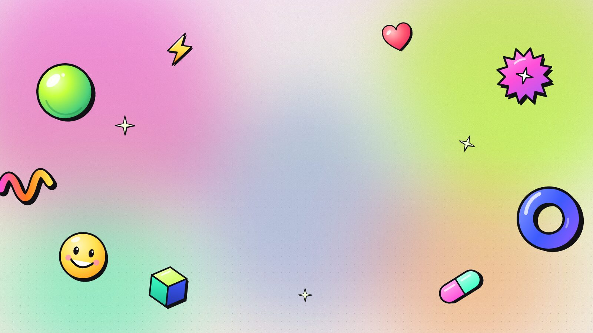

# yeet/ui ✦

**Loud, GSAP-animated UI components for plain HTML. Copy, paste, ship. ⚡**



Our in-house component library: loud colors, chunky ink borders, hard offset shadows and buttery [GSAP](https://gsap.com) motion. It's just HTML classes plus one `yeet.init()` call, so it works with plain HTML, React, Vue, Astro, or whatever you're shipping.

This repo holds the library itself and a 5-page showcase site (live demos, copy-paste code, API tables, design tokens, a theme remixer and ⌘K search).

---

## Quick start

```bash
npm install
npm run dev       # showcase site at http://localhost:5173
npm run build     # production build → dist/
npm run preview   # serve the build
```

## Use it in a project

**1. Copy the library files** (that's the whole library):

```
ui/
├─ tokens.css       colors, type, shape, motion
├─ components.css   every .y-* class
├─ components.js    behaviours + yeet.init()
└─ search.js        only if you use ⌘K search
```

They live in `src/styles/tokens.css`, `src/styles/components.css`, `src/components.js` and `src/search.js`.

**2. Add GSAP and the stylesheets**

```bash
npm i gsap
```

```html
<link rel="stylesheet" href="/ui/tokens.css" />
<link rel="stylesheet" href="/ui/components.css" />
```

Fonts (optional, but they're the vibe): Bricolage Grotesque, Space Grotesk and JetBrains Mono from Google Fonts.

**3. Wake the components up**

```js
import { yeet } from "./ui/components.js";

yeet.init();            // tabs, accordions, modals, toasts, tilt, marquee, navbar…
yeet.toast("Shipped! 🚀", { emoji: "✅", bg: "var(--y-lime)" });
```

**4. Drop in markup**

```html
<button class="y-btn y-btn--pink" data-toast="Shipped!">Ship it</button>
```

## Components

| | | |
|---|---|---|
| 🔘 Button | 🏷️ Badge & Chip | 🃏 Card |
| ⌨️ Input | 🎚️ Toggle | ✅ Checkbox |
| 🎛️ Slider | 📑 Tabs | 🪗 Accordion |
| 🪟 Modal | 🍞 Toast | 🧑‍🎤 Avatar |
| ⏳ Progress | 💬 Tooltip | 🎞️ Marquee |
| 🧭 Navbar | 🔍 Search (⌘K) | |

Every component has live examples, copy-paste HTML and a full API table on the **Docs** page.

## Theming

Override tokens, not components. Paste a theme after `tokens.css`:

```css
:root {
  --y-lime: #3dffc5;     /* primary accent */
  --y-pink: #9b5cff;     /* pop color */
  --y-radius: 22px;
  --y-shadow: 7px 7px 0 var(--y-ink);
}
```

The **Usage → Theme remix** page builds this for you with live knobs.

## The showcase site

| Page | What's there |
|---|---|
| **Home** | Hero with parallax props, live page previews, a sideways component reel |
| **Components** | The full lineup, filterable by category or name |
| **Docs** | Live preview / code / API for every component, with a progress sidebar |
| **Tokens** | Colors, typography, radius, shadows and motion easings |
| **Usage** | 4-step install, theme remixer, framework recipes, house rules, FAQ |

Shared navbar, footer and overlays live in `partials/` and are injected into every page at build time by a tiny Vite plugin (`vite.config.js`). Page transitions, the first-visit loader and ⌘K search live in `src/shell.js`. Component data for the docs comes from one registry, `src/registry.js`: add an entry there and it shows up in the docs, the Components grid, the sidebar and search.

## Accessibility

Native inputs under the toggles and checkboxes, ARIA on tabs, accordion, modal and search, full keyboard support for tabs and search, and every animation respects `prefers-reduced-motion`.

## Tech

[GSAP](https://gsap.com) (ScrollTrigger, Flip, Draggable, Inertia) · [Vite](https://vite.dev) · vanilla JS · CSS custom properties

---

made with 💖 + GSAP
